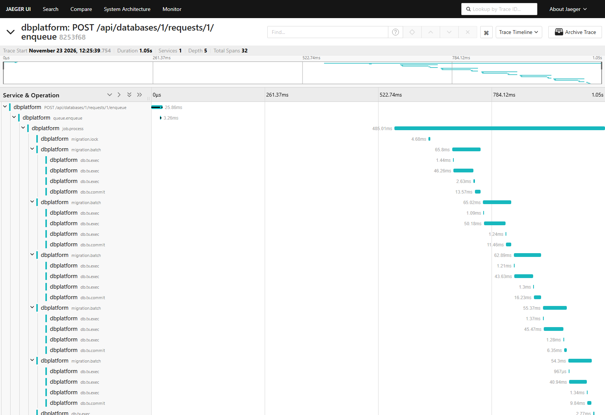
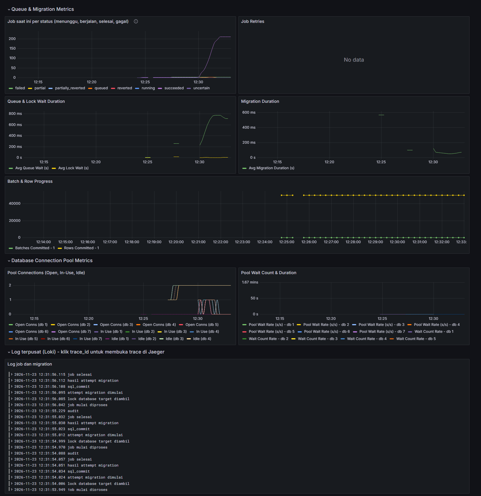

# Observability: logging, tracing, metrik, dan korelasinya

Dokumen ini berisi **output asli** dari satu skenario yang dijalankan
23 November 2026: migration **per batch** pada tabel `produk` berisi 50.000
row dengan ukuran batch 10.000 (5 batch), diajukan lewat request, di-approve
leader, lalu di-enqueue. Server dijalankan dengan
`OTEL_TRACES_EXPORTER=otlp OTEL_LOGS_EXPORTER=otlp` ke stack `obs`
(OpenTelemetry Collector, Jaeger, Loki, Prometheus, Grafana).

Semua potongan di bawah memakai trace yang sama:

```
trace_id = 8253f687e03dd309a0e02880ae8f3b06
```

Satu-satunya perubahan pada output adalah nama host laptop di `worker_id`
yang diganti `<host>`.

## Alur data

```
aplikasi (Go)
  ├─ log JSON ──────────── stdout/stderr (selalu)
  ├─ log OTLP/HTTP ─────┐
  ├─ trace OTLP/HTTP ───┤─► OpenTelemetry Collector ─┬─► Loki   (log)
  │                     │                            └─► Jaeger (trace)
  └─ GET /metrics ◄──────────── Prometheus (scrape 5 s)
                                         │
Grafana: dashboard metrik + panel log Loki; trace_id di log → tautan ke Jaeger,
dari span Jaeger → log Loki dengan trace_id yang sama.
```

## 1. Log JSON di stdout

Request enqueue (API), worker yang mengambil job, lock, satu batch lengkap
(mulai, hasil, commit), dan hasil akhir. Semua log punya `trace_id` yang
sama; log SQL membawa `job_id`, `execution_id`, `migration_id`, `attempt`,
dan `batch`.

```json
{"time":"2026-11-23T12:25:39.7804845+07:00","level":"INFO","msg":"http","event":"http_request","actor":"admin","status":202,"correlation_id":"demo-enqueue-batch-1","method":"POST","path":"/api/databases/1/requests/1/enqueue","dur_ms":25,"database":"1","trace_id":"8253f687e03dd309a0e02880ae8f3b06","span_id":"bbbd02d2f3c15c86","request_id":"demo-enqueue-batch-1"}
{"time":"2026-11-23T12:25:40.3151006+07:00","level":"INFO","msg":"job mulai diproses","worker_id":"<host>-32068-609b1a58","job_id":1,"db_id":1,"migration_id":1,"attempt":1,"kind":"up","mode":"batch","event":"job.start","queue_wait_ms":536,"trace_id":"8253f687e03dd309a0e02880ae8f3b06","span_id":"c7aec98f1d258601","job_id":1,"migration_id":1,"attempt":1}
{"time":"2026-11-23T12:25:40.398134+07:00","level":"INFO","msg":"lock session database target diambil untuk seluruh job batch","event":"migration.lock","status":"acquired","db_id":1,"mode":"batch","trace_id":"8253f687e03dd309a0e02880ae8f3b06","span_id":"c7aec98f1d258601","job_id":1,"migration_id":1,"attempt":1}
{"time":"2026-11-23T12:25:40.4409672+07:00","level":"INFO","msg":"migration batch dimulai","event":"migration.batch_start","db_id":1,"version":1,"user":"admin","sql":"UPDATE produk SET harga = harga * 2 WHERE id > $1 AND id <= $2","batch_size":10000,"resume_from_batch":1,"cursor":0,"trace_id":"8253f687e03dd309a0e02880ae8f3b06","span_id":"c7aec98f1d258601","job_id":1,"execution_id":1,"migration_id":1,"attempt":1}
{"time":"2026-11-23T12:25:40.450968+07:00","level":"INFO","msg":"sql_start","event":"sql_start","query":"UPDATE produk SET harga = harga * 2 WHERE id > $1 AND id <= $2","database":"1","params":[0,10000],"trace_id":"8253f687e03dd309a0e02880ae8f3b06","span_id":"32d57b1d5b04d64d","job_id":1,"execution_id":1,"migration_id":1,"attempt":1,"batch":1}
{"time":"2026-11-23T12:25:40.497228+07:00","level":"INFO","msg":"sql_result","event":"sql_result","query":"UPDATE produk SET harga = harga * 2 WHERE id > $1 AND id <= $2","database":"1","params":[0,10000],"dur_ms":46,"rows_affected":10000,"status":"success","trace_id":"8253f687e03dd309a0e02880ae8f3b06","span_id":"7b716fd0502d30d3","job_id":1,"execution_id":1,"migration_id":1,"attempt":1,"batch":1}
{"time":"2026-11-23T12:25:40.5134333+07:00","level":"INFO","msg":"sql_commit","event":"sql_commit","database":"1","dur_ms":8,"status":"success","trace_id":"8253f687e03dd309a0e02880ae8f3b06","span_id":"859804a77baf34d6","job_id":1,"execution_id":1,"migration_id":1,"attempt":1,"batch":1}
{"time":"2026-11-23T12:25:40.7783541+07:00","level":"INFO","msg":"migration batch selesai","event":"migration.batch_done","db_id":1,"batches":5,"rows":50000,"trace_id":"8253f687e03dd309a0e02880ae8f3b06","span_id":"c7aec98f1d258601","job_id":1,"execution_id":1,"migration_id":1,"attempt":1}
{"time":"2026-11-23T12:25:40.7896547+07:00","level":"INFO","msg":"hasil attempt migration","event":"migration.attempt_result","status":"success","db_id":1,"error":"","trace_id":"8253f687e03dd309a0e02880ae8f3b06","span_id":"c7aec98f1d258601","job_id":1,"execution_id":1,"migration_id":1,"attempt":1}
{"time":"2026-11-23T12:25:40.800115+07:00","level":"INFO","msg":"job selesai","worker_id":"<host>-32068-609b1a58","job_id":1,"db_id":1,"migration_id":1,"attempt":1,"kind":"up","mode":"batch","duration_ms":481,"event":"job.finish","status":"succeeded","reason":"","trace_id":"8253f687e03dd309a0e02880ae8f3b06","span_id":"c7aec98f1d258601","job_id":1,"migration_id":1,"attempt":1}
```

## 2. Span (Jaeger)

Pohon span dari `GET /api/traces/{trace_id}` Jaeger. Span `db.*` hanya
ditampilkan untuk batch 1 supaya ringkas; batch lain punya span yang sama.

```
trace_id=8253f687e03dd309a0e02880ae8f3b06  service=dbplatform  jumlah span=32
POST /api/databases/1/requests/1/enqueue  [25.9 ms] span_id=bbbd02d2f3c15c86
  queue.enqueue  [3.3 ms] span_id=2ee3dc54d9fbc734  db.id=1 job.mode=batch job.id=1
    job.process  [485.0 ms] span_id=c7aec98f1d258601  job.id=1 db.id=1 job.attempt=1 job.result=succeeded
      migration.lock  [4.7 ms] span_id=21142eb5d6b90716  db.id=1 lock.scope=session lock.acquired=True
      migration.batch  [65.8 ms] span_id=32d57b1d5b04d64d  db.id=1 job.id=1 batch.no=1 batch.lower=0 batch.upper=10000 batch.rows=10000
        db.tx.exec  [1.4 ms] span_id=0a71692c0c0eaaf2
        db.tx.exec  [46.3 ms] span_id=7b716fd0502d30d3
        db.tx.exec  [2.6 ms] span_id=a506dba8fe36efcf
        db.tx.commit  [13.6 ms] span_id=859804a77baf34d6
      migration.batch  [65.0 ms] span_id=0b0c1cb248cbd197  db.id=1 job.id=1 batch.no=2 batch.lower=10000 batch.upper=20000 batch.rows=10000
      migration.batch  [62.9 ms] span_id=c9f883874cfee98e  db.id=1 job.id=1 batch.no=3 batch.lower=20000 batch.upper=30000 batch.rows=10000
      migration.batch  [55.4 ms] span_id=0c45efb9f367e9ee  db.id=1 job.id=1 batch.no=4 batch.lower=30000 batch.upper=40000 batch.rows=10000
      migration.batch  [54.3 ms] span_id=9b996af533dc74c6  db.id=1 job.id=1 batch.no=5 batch.lower=40000 batch.upper=50000 batch.rows=10000
      db.tx.exec  [2.8 ms] span_id=45d0382a7b84b2b8
      db.tx.exec  [2.1 ms] span_id=23987d5d6cfeb783
      db.tx.commit  [1.0 ms] span_id=5621c8bae146dc7d
```

- `traceparent` disimpan di kolom `jobs.trace_context` oleh span
  `queue.enqueue`, lalu worker melanjutkannya sebagai `job.process`: rantai
  API → queue → worker → lock → batch → query tersambung dalam satu trace.
- Log `sql_commit` batch 1 di atas punya `span_id` yang sama dengan span
  `db.tx.commit` di bawah `migration.batch` no. 1.
- Span yang gagal berstatus `ERROR` dan mencatat exception (diuji di
  `TestBatchTracingLockAndPerBatchSpans`).



## 3. Log yang sama di Loki

Query LogQL `{service_name="dbplatform"} | trace_id="8253f687e03dd309a0e02880ae8f3b06"`.
Atribut log (`trace_id`, `span_id`, `job_id`, `actor`, `event`, ...) disimpan
sebagai structured metadata.

```
{"line": "job mulai diproses", "service_name": "dbplatform", "event": "job.start", "job_id": "1", "trace_id": "8253f687e03dd309a0e02880ae8f3b06", "span_id": "c7aec98f1d258601"}
{"line": "lock session database target diambil untuk seluruh job batch", "service_name": "dbplatform", "event": "migration.lock", "status": "acquired", "job_id": "1", "trace_id": "8253f687e03dd309a0e02880ae8f3b06", "span_id": "c7aec98f1d258601"}
{"line": "job selesai", "service_name": "dbplatform", "event": "job.finish", "status": "succeeded", "job_id": "1", "trace_id": "8253f687e03dd309a0e02880ae8f3b06", "span_id": "c7aec98f1d258601"}
total log trace ini di Loki: 48
```

## 4. Metrik Prometheus

Nilai dari Prometheus setelah job selesai. Angkanya cocok dengan log:
waktu tunggu antrean 0,536 s = `queue_wait_ms: 536` di log `job.start`,
durasi migration 0,481 s = `duration_ms: 481` di log `job.finish`, serta 5
batch dan 50.000 row.

```
dbp_jobs {'__name__': 'dbp_jobs', 'status': 'succeeded'} 1
dbp_batches_processed_total {'__name__': 'dbp_batches_processed_total', 'db': '1'} 5
dbp_rows_processed_total {'__name__': 'dbp_rows_processed_total', 'db': '1'} 50000
dbp_queue_wait_seconds_sum/dbp_queue_wait_seconds_count {} 0.536371
dbp_lock_wait_seconds_count {'__name__': 'dbp_lock_wait_seconds_count'} 1
dbp_migration_duration_seconds_sum {'__name__': 'dbp_migration_duration_seconds_sum'} 0.481293
dbp_pool_open_connections {'__name__': 'dbp_pool_open_connections', 'db_id': '1'} 0
dbp_pool_idle_connections {'__name__': 'dbp_pool_idle_connections', 'db_id': '1'} 0
dbp_pool_in_use_connections {'__name__': 'dbp_pool_in_use_connections', 'db_id': '1'} 0
```

`dbp_jobs` adalah gauge jumlah job **saat ini** per status, dihitung dari
tabel `jobs` setiap kali di-scrape. Label hanya `status`, `db`/`db_id`
(jumlah nilainya terbatas); tidak ada ID user, ID job, atau SQL sebagai label.

## 5. Dashboard Grafana

Dashboard `DB-Platform Observability` (provisioning otomatis dari
`deploy/observability/grafana/dashboards/dbplatform.json`), diambil saat
beban k6 singkat (210 job) berjalan: jumlah job per status, waktu tunggu
antrean dan lock, durasi migration, progres batch/row, koneksi pool
open/in-use/idle dan waktu tunggu koneksi, serta panel log Loki.



## Menjalankan ulang

```bash
docker compose --profile obs up -d otel-collector loki jaeger prometheus grafana
OTEL_TRACES_EXPORTER=otlp OTEL_LOGS_EXPORTER=otlp OTEL_EXPORTER_OTLP_ENDPOINT=http://localhost:4318 make run
```

| Komponen | Alamat |
|---|---|
| Grafana (tanpa login, hanya baca) | http://localhost:3000 |
| Jaeger | http://localhost:16686 |
| Prometheus | http://localhost:9090 |
| Loki | http://localhost:3100 |
| Collector OTLP | gRPC 4317, HTTP 4318 |
